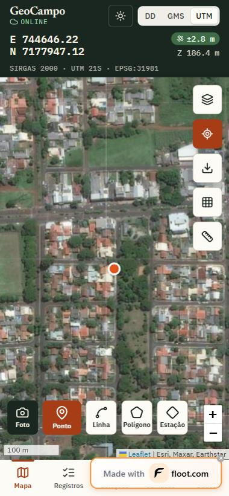
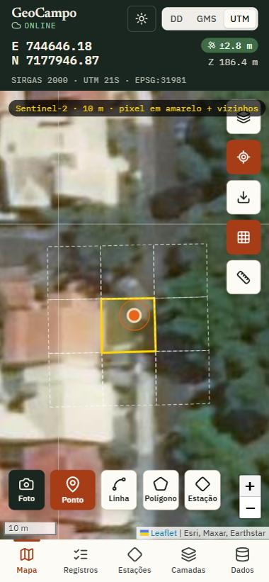
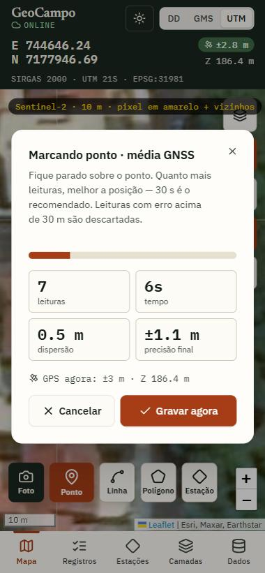
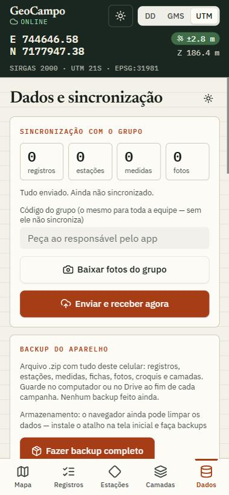

# GeoCampo — caderneta digital de campo (SIG de bolso offline)

App web progressivo (PWA) para **coleta de dados ambientais em campo** no celular e no tablet: pontos, linhas e polígonos com GPS, estações de monitoramento, fichas descritivas (solo, intemperismo, escoamento, rupturas), fotos georreferenciadas com croqui, camadas offline e exportação para SIG. Funciona **sem internet**: tudo fica salvo no aparelho e é sincronizado com o grupo quando há conexão.

**App publicado:** https://geocampo.floot.app · Responsável: Geógrafo **Renesky Jean Mary**

<p>




</p>

## Funcionalidades

| Área | O que faz |
|---|---|
| **Coordenadas** | Painel com DD, GMS e UTM (SIRGAS 2000, fuso detectado pela longitude); altitude elipsoidal e ortométrica (modelo geoidal) |
| **Captura** | Ponto por **média GNSS** (várias leituras, dispersão e precisão final), linha por rastro automático ou toque no mapa, polígono com área em campo |
| **Mapa** | Satélite, topográfico e ruas com **cache offline**; download da área da tela; régua de distância/área; grade do **pixel Sentinel-2 (10 m) e Landsat (30 m)** sobre a posição |
| **Camadas** | Importa KML, KMZ, GeoJSON, GPX, Shapefile (.zip), CSV, **GeoTIFF** (ortomosaico, MDT reprojetado) e **MBTiles**; aceita qualquer EPSG; camadas online XYZ/WMS |
| **Fichas** | Dicionários de perfil de solo, intemperismo, escoamento e mecanismo de ruptura; fichas personalizadas; clinômetro pelos sensores do aparelho |
| **Monitoramento** | Estações (pinos fixos) com histórico de medidas para comparação temporal; navegação até alvos |
| **Mídia** | Câmera com EXIF (coordenadas, altitude, precisão, azimute) e croqui desenhado sobre a foto |
| **Saídas** | **GeoPackage (.gpkg)**, Shapefile, KML, GeoJSON e CSV, em WGS 84, SIRGAS 2000 ou UTM; relatório da caderneta em **PDF** |
| **Offline-first** | Banco local (IndexedDB/Dexie), sincronização em lote com o servidor, backup completo em .zip |

## Estrutura do código

O app foi construído na plataforma [Floot](https://floot.com) (React + TypeScript, endpoints serverless e PostgreSQL).

```
pages/_index.tsx        tela principal (abas Mapa, Registros, Estações, Camadas, Dados)
components/             FieldMap (Leaflet), PhotoCapture, RecordSheet, StationSheet, FichaEditor,
                        GnssAverage, Clinometer, CoordPanel, ExportPanel, ... e o kit de interface
helpers/                geo, geoid, crsRegistry (proj4), importLayer, exportData (GeoPackage/SHP/KML),
                        reportPdf (jsPDF), photoExif, localDb (Dexie), syncEngine, backup, schema
endpoints/              sync_POST, photo-upload_POST, photos-list_POST, me_GET
base.css                tema "caderneta de campo" (claro, escuro e "sol forte")
```

Principais bibliotecas: Leaflet, proj4, Dexie, jsPDF, sql.js, shpjs, @tmcw/togeojson, @mapbox/shp-write, JSZip, piexifjs, geomagnetism, Turf.

## O que não está no repositório

- **Código de acesso do grupo:** retirado. Em `helpers/groupAuth.tsx`, defina o seu próprio código pela variável de ambiente `GEOCAMPO_GROUP_CODE` (ou pela linha `group_code_sha256` da tabela `appSettings`).
- **Credenciais do banco:** o acesso ao PostgreSQL vem de `FLOOT_DATABASE_URL`, que não fica no código.
- **Arquivos internos da plataforma** e exemplos do kit de interface.

Para rodar fora do Floot é preciso adaptar os pacotes específicos da plataforma (como `@floot/viewer`) e o roteamento dos endpoints.

## Licença

[MIT](LICENSE). Se usar ou adaptar, cite o autor.
